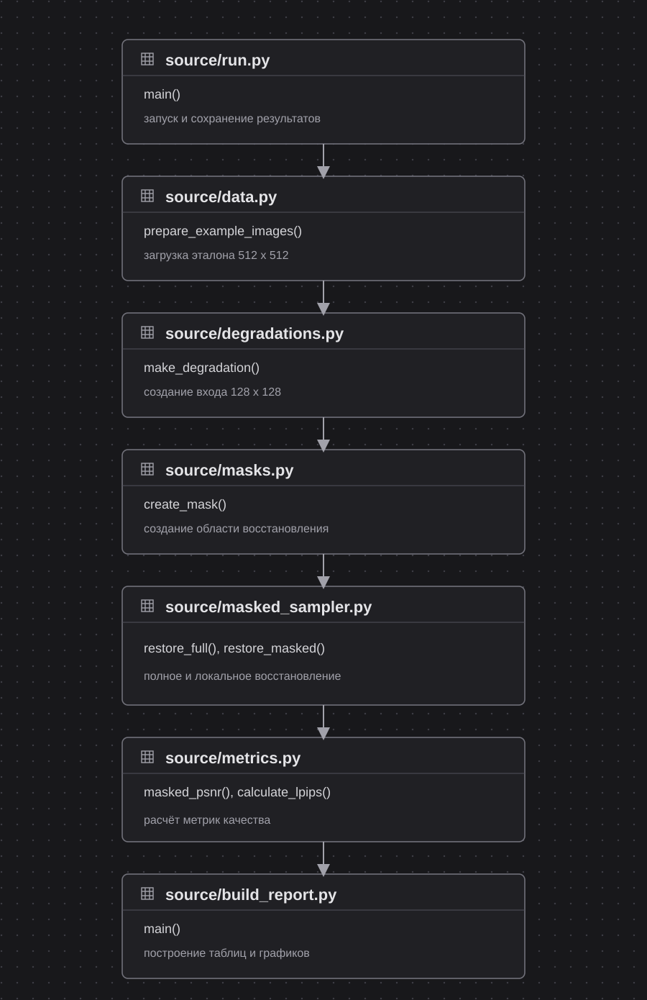
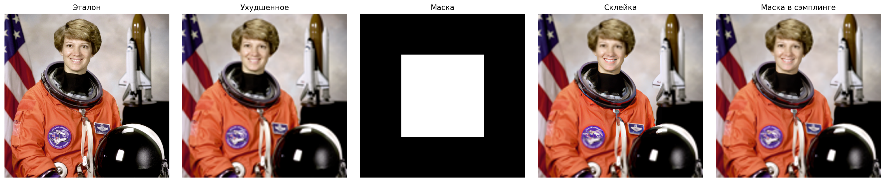
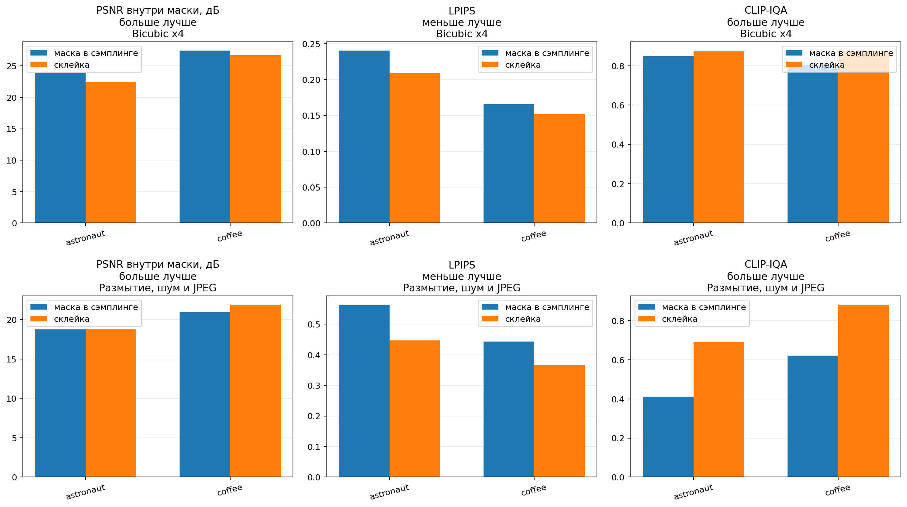

# Лабораторная работа №3. Локальное восстановление изображений диффузионной моделью

**Студент:** Гребенщиков Д. А.  
**Группа:** Р4140

## Цель работы

Изменить процесс сэмплинга предобученной диффузионной модели так, чтобы она восстанавливала только область, заданную маской. Проверить полную, пустую и комбинированные маски на нескольких изображениях и сравнить качество по PSNR, LPIPS и CLIP-IQA.

## Краткая теория

Диффузионная модель начинает со случайного шума и постепенно удаляет его. На каждом шаге сеть оценивает шум, после чего планировщик получает немного более чистое скрытое представление изображения.

В работе используется модель `CompVis/ldm-super-resolution-4x-openimages`. Она получает изображение низкого разрешения и увеличивает каждую сторону в четыре раза.

Для локального восстановления после каждого шага смешиваются две области:

```text
z_t = M * z_generated + (1 - M) * z_source
```

`M` является маской со значениями от 0 до 1. При `M = 1` используется результат модели. При `M = 0` сохраняется зашумлённое представление исходного изображения для текущего шага.

PSNR оценивает пиксельное отличие результата от эталона:

```text
PSNR = 10 * log10(1 / MSE)
```

Чем выше PSNR, тем меньше средняя ошибка. LPIPS сравнивает признаки изображений, меньшее значение означает большее сходство. CLIP-IQA оценивает воспринимаемое качество без эталона, большее значение считается лучшим.

## Порядок выполнения



| Этап | Что выполняется | Реализация |
|---:|---|---|
| 1 | Запуск эксперимента и перебор выбранных параметров | [`source/run.py`](source/run.py) |
| 2 | Загрузка и подготовка эталонных изображений | [`source/data.py`](source/data.py) |
| 3 | Уменьшение изображения и добавление искажений | [`source/degradations.py`](source/degradations.py) |
| 4 | Создание бинарной маски | [`source/masks.py`](source/masks.py) |
| 5 | Обычное и локальное восстановление | [`source/masked_sampler.py`](source/masked_sampler.py) |
| 6 | Сохранение изображений, PSNR и ошибки вне маски | [`source/run.py`](source/run.py), [`source/metrics.py`](source/metrics.py) |
| 7 | Расчёт LPIPS и CLIP-IQA | [`source/evaluate.py`](source/evaluate.py) |
| 8 | Построение сравнений для отчёта | [`source/build_report.py`](source/build_report.py), [`source/plots.py`](source/plots.py) |

В базовом варианте модель сначала восстанавливает всё изображение, затем готовый результат вставляется по маске. В изменённом варианте маска применяется на каждой итерации удаления шума.

Модель и метрики загружаются один раз и сохраняются в пользовательском кэше. В репозиторий веса не добавляются.

## Требования

- Python 3.9 или новее
- около 2 ГБ свободного места под веса
- подключение к интернету при первом запуске
- CPU, CUDA или Apple MPS

Модель LDM выбрана вместо более тяжёлой SUPIR, поскольку она запускается на CPU и позволяет напрямую изменить цикл удаления шума. Устройство выбирается автоматически.

## Постановка эксперимента

| Параметр | Значение |
|---|---|
| Изображения | astronaut, coffee |
| Размер эталона | 512 x 512 |
| Размер входа модели | 128 x 128 |
| Искажения | bicubic x4, blur + noise + JPEG |
| Маски | пустая, полная, прямоугольная, мягкая |
| Методы | склейка готового результата, маска внутри сэмплинга |
| Шаги диффузии | 10 |
| Seed | 42 |
| Метрики | PSNR, LPIPS, CLIP-IQA, ошибка вне маски |

Пустая маска проверяет сохранение исходного изображения. Полная маска должна совпасть с обычным восстановлением всей площади. Прямоугольная и мягкая маски проверяют локальный режим. Для каждой комбинации используется одинаковый `seed`.

## Реализация

### Ухудшение изображения

Для известного искажения используется уменьшение bicubic. Неизвестное искажение объединяет размытие, гауссов шум и JPEG-сжатие.

```python
low_res = bicubic_downscale(image).filter(ImageFilter.GaussianBlur(radius=1.2))
noise = rng.normal(0.0, 6.0, pixels.shape)
noisy.save(buffer, format="JPEG", quality=45)
```

### Маска внутри сэмплинга

Перед очередным предсказанием шума скрытое представление вне маски заменяется представлением исходника на том же уровне шума.

```python
source_at_t = pipeline.scheduler.add_noise(
    source_latents,
    source_noise,
    timestep_batch,
)
latents = latent_mask * latents + (1.0 - latent_mask) * source_at_t
```

Это является основным изменением стандартного процесса сэмплинга. Простая склейка изменяет только готовое изображение и используется как базовый вариант для сравнения.

После последнего шага применяется исходная маска. Это гарантирует, что область с нулевым значением не изменится.

### Проверка сохранения области

Вне маски считается средняя абсолютная разница с bicubic-версией:

```text
outside_MAE = mean(abs(result - bicubic)) вне маски
```

Чем ближе значение к нулю, тем точнее сохранена область, которую модель не должна менять.

## Запуск

```bash
python3 -m venv .venv
source .venv/bin/activate
pip install -r requirements.txt
python -m source.run --smoke --steps 5
python -m source.run \
  --images astronaut,coffee \
  --degradations bicubic,unknown \
  --masks zero,full,center,soft_center \
  --steps 10
python -m source.evaluate
python -m source.build_report
```

Первый запуск скачивает модель. Быстрая проверка обрабатывает одно изображение и проверяет три основные маски. Команда `source.evaluate` отдельно загружает веса LPIPS и CLIP-IQA. Последняя команда строит изображения и график. Разделение уменьшает расход памяти.

Метрики можно проверять отдельно:

```bash
python -m source.evaluate --skip-clip
python -m source.evaluate --skip-lpips
```

Отдельный фрагмент эксперимента можно пересчитать без повторения остальных:

```bash
python -m source.run \
  --images astronaut \
  --degradations unknown \
  --masks zero,full,center,soft_center \
  --steps 10 \
  --append
```

## Результаты

Получено 32 результата. Пустая маска вернула bicubic-изображение без изменений. Полная маска совпала со стандартным восстановлением модели.

Средние значения для прямоугольной маски по двум изображениям:

| Искажение | Метод | PSNR внутри маски, дБ | LPIPS | CLIP-IQA | Время, с |
|---|---|---:|---:|---:|---:|
| Bicubic x4 | Склейка | 24,60 | 0,181 | 0,875 | 42,43 |
| Bicubic x4 | Маска в сэмплинге | 25,68 | 0,203 | 0,827 | 54,42 |
| Размытие, шум и JPEG | Склейка | 20,34 | 0,406 | 0,787 | 43,56 |
| Размытие, шум и JPEG | Маска в сэмплинге | 19,84 | 0,504 | 0,516 | 56,91 |

На bicubic пошаговая маска повысила PSNR внутри области в среднем на 1,08 дБ. При сильном комбинированном искажении склейка дала лучшие значения всех трёх метрик.

Для мягкой маски пошаговый вариант изменял внешнюю область слабее. Средняя `outside_MAE` уменьшилась с `0,0011` до `0,0003` на bicubic и с `0,0017` до `0,0002` на комбинированном искажении.



На bicubic простая склейка создаёт заметную квадратную границу. Маска внутри сэмплинга делает переход мягче.


При сильном искажении пошаговое ограничение мешает модели полноценно восстановить выбранную область. В этом случае готовый восстановленный фрагмент выглядит резче.



## Ограничения

Эксперимент выполнен на двух изображениях и десяти шагах диффузии на CPU. Результат показывает поведение алгоритма в выбранных условиях, но не является общей оценкой модели на всём DIV2K. Для запуска нужны Python 3.9 или новее и около 2 ГБ свободного места под веса модели и метрик.

## Вывод

Изменение процесса сэмплинга позволило восстанавливать заданную область и точно сохранять остальные пиксели. На bicubic метод повысил PSNR и сгладил границу маски, но при сильном комбинированном искажении простая склейка дала лучшее качество, поскольку пошаговое ограничение уменьшило свободу модели.

## Источники

- [LDM Super Resolution 4x](https://huggingface.co/CompVis/ldm-super-resolution-4x-openimages)
- [RePaint](https://huggingface.co/docs/diffusers/main/en/api/pipelines/repaint)
- [LPIPS](https://lightning.ai/docs/torchmetrics/stable/image/learned_perceptual_image_patch_similarity.html)
- [CLIP-IQA](https://lightning.ai/docs/torchmetrics/stable/multimodal/clip_iqa.html)

